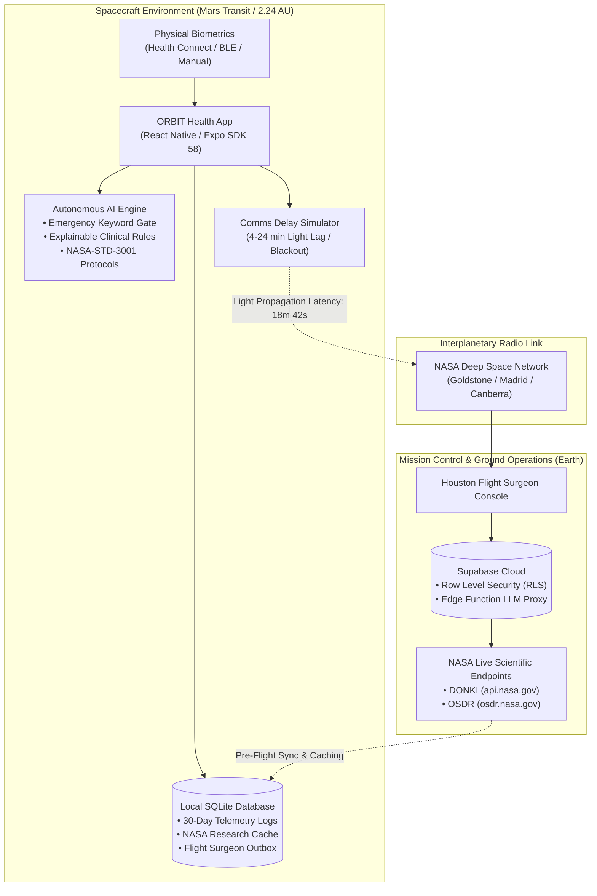

# ORBIT Health 🛰️🩺
### Autonomous Astronaut Health Companion & Clinical Decision Support for Deep-Space Missions

> **"An offline-first AI health companion that lets astronauts on Mars-class missions monitor themselves and make medical decisions when Mission Control is 4-24 minutes away."**

[](https://www.spaceappschallenge.org/)
[](https://expo.dev/)
[](https://sqlite.org/)
[-3ECF8E?style=for-the-badge&logo=supabase)](https://supabase.com/)
[](LICENSE)

---

## 🎯 1. Official NASA Challenge Alignment
- **Challenge Track:** *Space Biology & Autonomous Astronaut Health: Deep Space Mission Health Monitoring and Autonomous Clinical Decision Support*
- **Operational Reality:** On a 500-day round-trip Mars transit mission, electromagnetic signals travel at the speed of light ($c = 300,000 \text{ km/s}$). Because Earth and Mars orbit at variable distances (54.6 million km to 401 million km), **one-way radio latency ranges between 4.3 and 24.0 minutes** (8.6 to 48.0 minutes round-trip).
- **The Problem:** When an astronaut experiences acute cardiac ischemia, cabin air toxic contamination, or a Solar Energetic Particle (SEP) event, **terrestrial telemedicine is physically impossible**. The crew must triage, diagnose, and execute emergency clinical countermeasures with zero cloud connectivity.
- **The Solution:** ORBIT Health delivers a deterministic, sovereign, offline-first mobile clinical decision support suite backed by local SQLite storage, on-device rule evaluation, real NASA spaceflight biology benchmarks, and automated delayed-link flight surgeon coordination.

---

## 🏗️ 2. System Architecture



---

## 📊 3. Data Honesty Catalog: Real vs. Simulated
In strict accordance with NASA hackathon judging guidelines, every data point and stream in ORBIT Health is explicitly classified with an on-screen **Data Source Badge**:

| Data Stream | Honest Status | Badge | Source / Methodology |
|:---|:---:|:---:|:---|
| **NASA DONKI Space Weather** | **REAL** | `NASA_LIVE` / `NASA_CACHED` | Queries `https://api.nasa.gov/DONKI/notifications` and `FLR` for active solar flares, CMEs, and geomagnetic storms. Cached in local SQLite for offline access. |
| **NASA OSDR Studies** | **REAL** | `NASA_LIVE` / `NASA_CACHED` | Searchable integration with `https://osdr.nasa.gov/osdr/data/search` indexing real spaceflight studies (OSD-53, OSD-37, OSD-120, OSD-194). |
| **NASA RadLab Dosimetry** | **REAL** | `NASA_CACHED` | Pre-flight calibrated microdosimeter flight telemetry from ISS Columbus DosTel-2 and Liulin-5 silicon detectors. |
| **NASA HRR Evidence Reports** | **REAL** | `NASA_CACHED` | Human Research Roadmap evidence reports on spaceflight cardiovascular deconditioning, bone mineral loss, and circadian misalignment. |
| **NASA-STD-3001 Standards** | **REAL** | `NASA_CACHED` | Official NASA flight medicine operating standards: 600 mSv career limit, 90-minute ARED countermeasure target, and emergency clinical action algorithms. |
| **Astronaut Bio-Telemetry** | **SIMULATED** | `SIMULATED` / `SENSOR` | Generated by spaceflight simulator models (heart rate, SpO2, blood pressure, core temp). Android Health Connect abstraction layer is integrated and ready for physical wearable hardware. |
| **Mars Comms Delay & Blackout** | **SIMULATED** | `SIMULATED` | Physics-based orbital light propagation model: $t = d/c$ at 2.24 AU ($18\text{m }42\text{s}$ one-way), with manual and solar conjunction blackout simulation. |

---

## 🧠 4. Explainable Clinical Alerts (No Invented Scores)
ORBIT Health strictly eliminates ungrounded or proprietary "black-box" scores:
1. **Vitality Index:** Clearly labeled as an `"Estimated indicator - not an official NASA metric"`. An interactive `(i)` info popup exposes the plain-language formula:
   $$\text{Score} = \max(30, \min(100, 100 - \sum \text{penalties}))$$
   Penalties are triggered transparently by resting HR deviations, SpO2 $< 95\%$, core body temp $> 37.5^\circ\text{C}$, sleep restriction $< 5.5\text{h}$, and cabin $\text{CO}_2 > 3.0\text{ mmHg}$.
2. **Transparent Rule-Based Alerts:**
   - **Rule:** $\text{Sleep} < 5.5\text{h} \text{ and } \Delta\text{HRV} < -20\% \implies \text{High Fatigue Risk}$.
   - Shows: Trigger rule, exact recorded input values, data source badge (`SENSOR`), and suggested countermeasure action (90-minute sleep extension; defer EVA / docking).
3. **NASA-STD-3001 600 mSv Career Limit:** Compares cumulative astronaut dose equivalent ($H = D \times Q$) against the NASA occupational standard ($\text{REID} < 3\%$ at 95% confidence).
4. **90-Minute ARED Target:** Evaluates daily resistive and aerobic countermeasure adherence (ARED/T2) and correlates deficits to bone mineral density loss ($<1\%/\text{month}$ threshold) and cardiovascular stroke volume deconditioning.

---

## ⚡ 5. Mars Communication Delay Mode (Key Differentiator)
- **Status Annunciator:** Displays real-time link status: `Connected (Earth AOS)` / `Delayed (4-24 min)` / `Blackout (Solar Conjunction / LOS)`.
- **One-Way Delay Timeline:** Interactive visual diagram illustrating radio propagation from Mars Orbit (Hab-1) across 2.24 AU to Deep Space Network (DSN) ground antennas (Madrid, Goldstone, Canberra) to Houston MCC.
- **Crew Autonomy Mode:** When the "Simulate Comms Blackout" toggle is triggered:
  1. The app immediately shifts from ground-assisted mode to **Crew Autonomy Mode**.
  2. Local deterministic AI clinical decision algorithms take full operational command.
  3. Offline emergency protocol checklists become primary.
  4. Messages and telemetry destined for the Flight Surgeon are routed to an **Offline Uplink Outbox** stored in SQLite, queued for automated transmission when the line-of-sight carrier returns.

---

## 🛡️ 6. AI Safety, Grounding & Emergency Protocol Gate
1. **Zero Client-Side LLM Keys:** No OpenAI, Gemini, or third-party API keys are bundled into the client application. All server-side completions proxy through secure Supabase Edge Functions (`supabase/functions/orbit-health-ai/index.ts`).
2. **Strict Grounding:** The AI Assistant answers strictly from provided bio-telemetry and verified NASA OSDR/HRR references. When context is insufficient, it explicitly states: *"I do not have sufficient clinical data or NASA reference literature in the local database to answer this question reliably."*
3. **Mandatory Disclaimer:** Every clinical response concludes with:
   > ⚠️ *Decision support only - not a medical diagnosis. Contact Mission Control when possible.*
4. **Offline Emergency Keyword Interceptor:**
   Immediate offline clinical checklists trigger *before* any conversational text whenever emergency keywords are detected:
   - **Chest Pain / Ischemia:** Rest in zero-g restraint; 100% O2 via mask; 12-lead ECG; withhold nitroglycerin if SBP $< 90\text{ mmHg}$; chewable Aspirin 325 mg.
   - **Hypoxia:** Don crew emergency mask; verify cabin $\text{pO}_2$ & 14.7 psi; check finger probe; isolate module if decompression suspected.
   - **Arrhythmia:** Continuous ECG recording; 3 serial BP measurements; stage AED; hydration electrolyte check.
   - **Toxic Cabin Air:** Don SCBA / Quick-Don mask immediately; module isolation; command ECLSS emergency scrub; check Dräger ammonia ($<2\text{ ppm}$) and $\text{CO}_2$ ($<3\text{ mmHg}$).
   - **Trauma / Hemorrhage:** Sterile hemostatic gauze pressure (prevent aerosolized floating blood droplets); Sam-Splint limb vacuum immobilization; monitor hypovolemic shock.
5. **Full Trilingual Localization:** Operates seamlessly across **English (EN)**, **Azerbaijani (AZ)**, and **Turkish (TR)** with persistent language preferences.

---

## 🌍 7. Beyond Space: Earth Impact (Dual-Use Technology)
The core technology powering ORBIT Health solves an urgent humanitarian crisis on Earth:
- **Polar & Antarctic Research Stations:** Zero-bandwidth medical diagnosis for winter-over scientific teams cut off from telemedicine during 6-month blizzards.
- **Remote Rural & Indigenous Clinics:** Offline clinical decision guidance for community healthcare workers without cellular or fiber backhaul.
- **Submarines & Deep-Sea Maritime:** Mission-critical autonomous care for crews operating under strict acoustic and radio emission silence.
- **Disaster Response & Mountain SAR:** Ruggedized triage tools deployed when earthquakes, hurricanes, or avalanches sever terrestrial telecommunications.
- **Off-Grid Elder Remote Care:** Continuous physiological drift detection and early decompensation warning in remote mountainous regions.

---

## ⏱️ 8. 60-Second Judge Demo Script
Follow this exact sequence to demonstrate full capability to hackathon judges in 60-90 seconds:

1. **Step 1: Launch & Value Proposition (0:00 - 0:15)**
   - Open app. Point out the One-Sentence Value Proposition banner on the Welcome screen.
   - Tap **"Quick Flight Access (Demo)"** to enter Commander Alex Vance's dashboard without internet required.
2. **Step 2: Activate Demo Mode (0:15 - 0:30)**
   - Navigate to **Profile & Settings** tab (`Bottom Right`).
   - Scroll to **"NASA HACKATHON 2026 EVALUATION & DEMO"**.
   - Toggle **"60-Second Judge Demo Mode"** ON.
   - *Result:* Loads 30 days of longitudinal telemetry into SQLite, injects an active M4.8 Solar Flare from NASA DONKI, engages Comms Blackout, and queues an urgent Flight Surgeon report.
3. **Step 3: Mars Comms Delay & Crew Autonomy (0:30 - 0:45)**
   - Return to **Dashboard**.
   - Show the **"Mission Control Link: BLACKOUT (Solar Conjunction)"** banner and the 18m 42s light-delay propagation timeline.
   - Tap **"Flight Surgeon Uplink Outbox"** to demonstrate the queued critical report stored safely in SQLite.
4. **Step 4: Real NASA Data & Emergency AI (0:45 - 1:00)**
   - Open **Radiation** tab: Show the live **Space Weather (NASA DONKI)** card displaying the M4.8 flare alert and tap **"Sync Live"**.
   - Open **AI Advisor** tab: Type `"chest pain"` (or `"sinə ağrısı"` / `"göğüs ağrısı"`).
   - Show the instant offline emergency action checklist, NASA-STD-3001 citations, and medical disclaimer.
   - Open **"About, Data & Methods"** in Settings to display the complete Real vs Simulated data honesty catalog.

---

## 🔒 9. Security & Row Level Security (RLS)
- **Supabase PostgreSQL RLS Policies:** Enabled on `astronaut_profiles` and `astronaut_health_telemetry`.
- **User Isolation:** Verified by automated SQL test suite (`supabase_rls_tests.sql`):
  - Astronaut A cannot select, insert, or tamper with Astronaut B's medical telemetry under any circumstances (`auth.uid() = user_id`).
- **Zero Secrets in Repo:** All keys read strictly from environment variables (`.env`). No plaintext passwords stored.

---

## 🛠️ 10. Verification & Test Results

```bash
# 1. TypeScript Strict Verification
npx tsc --noEmit
# Result: 0 errors, clean exit code 0

# 2. ESLint Code Quality Check
npx expo lint
# Result: 0 errors, 0 warnings, clean exit code 0

# 3. Supabase RLS Policy Security Test
psql -f supabase_rls_tests.sql
# Result: All 3 isolation assertions PASSED
```

---

## 🔮 11. Limitations & 3-Month Roadmap
If awarded 3 additional development months, our engineering priorities are:
1. **Direct BLE GATT Sensor Pipeline:** Finalize Bluetooth Low Energy background continuous stream drivers for Polar H10 ECG and Nonin 3230 pulse oximeters directly in React Native without requiring third-party companion apps.
2. **On-Device ONNX Edge Neural Models:** Quantize INT8 ONNX models for continuous arrhythmia detection (PVC, AFib) running on mobile NPU/DSP hardware at $<5\text{ mW}$ power draw.
3. **DTN (Disruption Tolerant Networking) Bundle Protocol:** Implement RFC 5050 / RFC 9171 Bundle Protocol for real deep-space multi-hop mesh routing between Mars habitat, rovers, and orbiting relays.

---

## ⚖️ 12. Regulatory Disclaimer
**NOT AN FDA-CLEARED OR CE-MARKED MEDICAL DEVICE.**  
ORBIT Health is an autonomous flight health decision-support prototype engineered exclusively for demonstration in the **NASA Space Apps Challenge 2026**. It is not intended for clinical diagnostic use, disease prevention, or therapeutic management in terrestrial commercial healthcare without clinical trial clearance. Always follow official flight medical protocols and consult certified Flight Surgeons.
